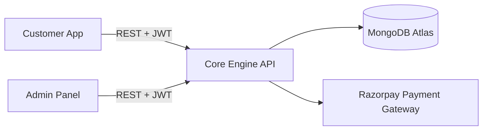

# Full-Stack Food Delivery Platform

> A production-style, monorepo food delivery system with a Spring Boot microservice-ready backend, JWT authentication, Razorpay payment integration, and dual React frontends (Customer App + Admin Panel).

**Repository:** [Food-Delivery-System](https://github.com/Tejas-Tupe/Food-Delivery-System)

---

## Overview

Full Stack Food Delivery System is a food ordering platform built to mirror how real production food delivery apps are engineered not a single-file CRUD demo. It's organized as a **monorepo with three independently deployable services**, uses **stateless JWT authentication**, integrates **real payment processing via Razorpay**, and implements a **multi-phase kitchen/order pipeline** with status based order tracking for live operations (placed → preparing → out for delivery → delivered/rejected).

It was built to demonstrate:
- Clean separation of concerns across a multi service architecture
- Secure, stateless authentication using Spring Security + JWT
- Real-world e-commerce problems: cart persistence, guest-to-user data migration, payment verification, and order-state management
- Production-shaped REST API design (proper HTTP status codes, DTOs, validation, centralized error handling)

---

## Architecture

This project follows a **monorepo, multi-service structure** — each service can be developed, tested, and deployed independently:

```
Food-Delivery-System/
├── foodisapi/foodisapi/       # Backend — Core Engine (Spring Boot + MongoDB)
├── frontend-user/             # Customer-facing React app (browse, cart, checkout, orders)
├── frontend-adminPanel/       # Admin React app (manage food items, track & update orders)
└── .gitignore
```

| Service | Role | Stack |
|---|---|---|
| **Core Engine** (`foodisapi`) | REST API, business logic, auth, payments, persistence | Spring Boot, Spring Security, MongoDB, JWT, Razorpay SDK |
| **Frontend – User** | Customer ordering experience | React |
| **Frontend – Admin Panel** | Restaurant/admin order & catalog management | React |



---

## Key Features

### Customer-facing
- User registration & login with **JWT-based stateless authentication**
- Browse food catalog by category with image support
- Add/update/remove cart items with quantity control
- **Guest cart → account cart migration** (see [Challenges](#-challenges--how-we-solved-them) below)
- Checkout with **Razorpay** payment integration and signature verification
- Automatic order rejection/rollback on payment failure
- View personal order history

### Admin-facing
- Add new food items with **image upload** (multipart form-data)
- Delete/manage catalog items
- **Multi-phase order pipeline**: view and filter orders by status (e.g. pending, preparing, out-for-delivery, delivered, rejected)
- Update order status in real time to drive the kitchen/delivery workflow

### Engineering
- Centralized exception handling with proper HTTP status codes (`ResponseStatusException`)
- DTO-based request/response contracts (no entity leakage over the API)
- MongoDB unique indexing on `email` (users) and `userId` (carts) to enforce data integrity
- Health-check endpoint for uptime monitoring / deployment readiness probes

---

## Tech Stack

**Backend (Core Engine)**
- Java 17+, Spring Boot 3.x
- Spring Security + JWT (`JwtUtil`, `AppUserDetailsService`)
- Spring Data MongoDB
- Razorpay Java SDK
- Lombok
- Maven

**Frontend (User + Admin)**
- React.js
- REST API integration via Axios/Fetch
- LocalStorage-based guest session handling

**Database & Infra**
- MongoDB (Atlas / self-hosted)
- Razorpay Payment Gateway (test/live modes)

---

## API Reference

**Base URL:** `/api`

| Method | Endpoint | Description | Auth |
|---|---|---|---|
| `POST` | `/api/register` | Register a new user | ❌ |
| `POST` | `/api/login` | Authenticate & receive JWT | ❌ |
| `GET` | `/api/foods` | List all food items | ❌ |
| `GET` | `/api/foods/{id}` | Get a single food item | ❌ |
| `POST` | `/api/foods` | Add food item (multipart: JSON + image) | ✅ Admin |
| `DELETE` | `/api/foods/{id}` | Delete a food item | ✅ Admin |
| `GET` | `/api/cart` | Get current user's cart | ✅ |
| `POST` | `/api/cart` | Add item to cart | ✅ |
| `PATCH` | `/api/cart/increase/{itemId}` | Increase item quantity | ✅ |
| `PATCH` | `/api/cart/decrease/{itemId}` | Decrease item quantity | ✅ |
| `DELETE` | `/api/cart/{id}` | Remove item from cart | ✅ |
| `DELETE` | `/api/cart` | Clear entire cart | ✅ |
| `POST` | `/api/cart/merge` | Merge guest (localStorage) cart into cloud cart on login | ✅ |
| `POST` | `/api/orders/create` | Create order + initiate Razorpay payment | ✅ |
| `POST` | `/api/orders/verify` | Verify Razorpay payment signature | ✅ |
| `POST` | `/api/orders/payment-failed` | Mark order as rejected on payment failure | ✅ |
| `GET` | `/api/orders/userorders` | Get logged-in user's order history | ✅ |
| `DELETE` | `/api/orders/{orderId}` | Delete/cancel an order | ✅ |
| `GET` | `/api/admin-orders/list/{status}` | List orders filtered by status | ✅ Admin |
| `PATCH` | `/api/admin-orders/status/{orderId}` | Update order status | ✅ Admin |
| `GET` | `/api/health` | Health check | ❌ |

---

## Data Model (MongoDB Collections)

- **users** — `id, name, email (unique), password`
- **foods** — `id, name, description, price, category, imageUrl`
- **carts** — `id, userId (unique), items: Map<foodId, quantity>`
- **orders** — `id, userId, userAddress, phoneNumber, email, orderItems[], amount, paymentStatus, orderStatus, razorpayOrderId, razorpayPaymentId, razorpaySignature`

---

## Challenges & How We Solved Them

### 1. Guest Cart → Authenticated Cart Synchronization

**The problem:** Customers browse and add items to their cart *before* logging in. We didn't want to force login just to add an item (that kills conversion) — but the cart still needed to end up tied to the user's account and persist across devices once they did log in.

**Our approach:**
- While a user is unauthenticated, cart items are stored entirely in the browser's `localStorage` — no backend calls, zero friction.
- The moment the user logs in, the frontend reads the local cart and sends it to a dedicated **`POST /api/cart/merge`** endpoint (`CartController.mergeCart`) with the pending items.
- The backend merges these into the user's existing cloud cart (`CartEntity`, keyed by a unique `userId` index) — combining quantities where the same item exists in both.
- Once the merge succeeds, `localStorage` is cleared so there's a single source of truth (the cloud cart) going forward, preventing stale/duplicate state.

**Why it was hard:** The tricky part wasn't storing the data — it was the *handoff moment*: making sure the merge is atomic enough that a user never sees their cart "flash empty" or lose items if the merge request fails, and making sure quantities are combined rather than overwritten if the same item exists in both places. This shaped the `CartMergeRequest` contract and the `Map<String, Integer>` structure on `CartEntity`, which made merge logic a simple key-wise addition instead of complex list reconciliation.

---

## Getting Started

### Prerequisites
- Java 17+
- Maven
- Node.js 18+ (runtime for Vite tooling only — the project itself has no Node.js backend/service)
- MongoDB (local instance or Atlas connection string)
- Razorpay account (test API keys)

### Backend — Core Engine
```bash
cd foodisapi/foodisapi
# Configure application.properties with:
#   spring.data.mongodb.uri=<your-mongodb-uri>
#   jwt.secret=<your-jwt-secret>
#   razorpay.key=<your-key>
#   razorpay.secret=<your-secret>
mvn spring-boot:run
```
API will start on `http://localhost:8080`.

### Frontend — User App
```bash
cd frontend-user
npm install
npm start
```

### Frontend — Admin Panel
```bash
cd frontend-adminPanel
npm install
npm start
```

---

## Roadmap

- [ ] Real-time order status updates via WebSockets
- [ ] Delivery partner tracking module
- [ ] Automated test suite (JUnit + React Testing Library)
- [ ] Dockerized multi-service deployment (docker-compose)

---

## Author

**Tejas Tupe** 
[GitHub](https://github.com/Tejas-Tupe) · [LinkedIn](https://www.linkedin.com/in/tejastupe/)

This project was built as a hands-on exploration of production backend architecture — authentication, payment integration, and multi-service system design — as part of my preparation and portfolio in Computer Science / Software Engineering.

---

## License

This project is licensed under the MIT License — feel free to fork and build on it.
